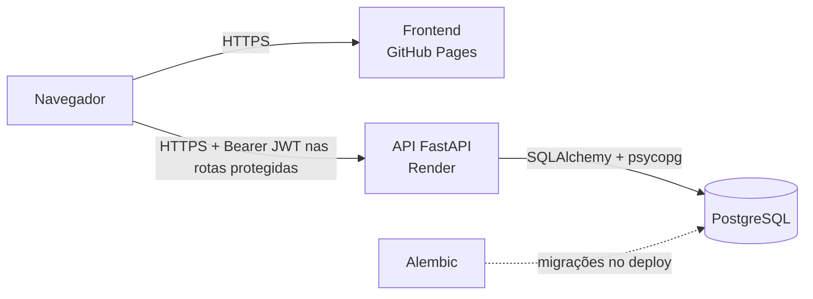

# Gerenciador de Tarefas API


API REST **multi-usuário** para tarefas pessoais. Tem login com JWT, cada conta acessa apenas as próprias tarefas e o frontend é feito em HTML, CSS e JavaScript puro.

[Demo](https://moisesmayyer.github.io/GerenciadorDeTarefas/) · [API](https://gerenciadordetarefas-eesn.onrender.com) · [Swagger](https://gerenciadordetarefas-eesn.onrender.com/docs)

> [!NOTE]
> Projeto de estudo e portfólio. Começou como um CRUD em FastAPI e cresceu para um sistema com contas, refresh token rotativo, migrações versionadas, testes de integração e deploy.

## Sumário

[Sobre](#sobre-o-projeto) · [Funcionalidades](#funcionalidades) · [Stack](#stack) · [Como rodar](#como-rodar) · [Deploy](#deploy) · [Como usar](#como-usar) · [Endpoints](#endpoints) · [Regras](#regras-de-negócio) · [Códigos](#códigos-de-status) · [Modelo de dados](#modelo-de-dados) · [Frontend](#frontend) · [Decisões](#decisões-técnicas) · [Qualidade](#qualidade) · [O que falta](#o-que-falta)

## Sobre o projeto

Com o sistema, você cria, conclui, cancela e exclui tarefas pessoais. Cada tarefa tem nome, descrição e um status: `pendente`, `concluido` ou `cancelado`.

O ponto central é o **multi-usuário**: cada conta vê apenas os próprios dados. Se tentar acessar algo de outra conta, a API responde **404**.



**O que o projeto cobre hoje:** autenticação, gestão de conta e CRUD de tarefas. Ficam de fora recursos como prioridade, prazo, etiquetas, compartilhamento e painel de administração.

## Funcionalidades

- **Contas:** cadastro, login, perfil, troca de senha, desativação e exclusão (que também apaga as tarefas).
- **Login:** senha protegida com **Argon2**, access token JWT de 30 minutos e refresh token de 7 dias que muda a cada uso. O logout revoga a sessão.
- **Tarefas:** criar, listar, buscar, atualizar, cancelar e excluir, com status, busca por descrição e paginação no servidor.
- **Isolamento:** toda consulta usa o `usuario_id` que vem do token, nunca do corpo da requisição.
- **Frontend:** login, sessão salva no navegador, renovação automática quando o token expira, tema claro/escuro, filtros, contadores e perfil em modal.
- **Produção:** migrações com Alembic, CORS restrito, limite de requisições e CI no GitHub Actions.

## Stack

| Camada | Tecnologia |
|---|---|
| Linguagem | Python 3.11+ (CI em 3.14) |
| Framework | FastAPI 0.143 + Uvicorn |
| ORM / banco | SQLAlchemy 2.1 + PostgreSQL (psycopg 3) |
| Validação | Pydantic 2.14 + pydantic-settings |
| Migrações | Alembic 1.20 |
| Autenticação | PyJWT (HS256), pwdlib (Argon2), slowapi |
| Frontend | HTML5, CSS3 e JavaScript (módulos ES) |
| Testes | pytest + TestClient sobre PostgreSQL real |
| Deploy | Render (API) + GitHub Pages (frontend) |

## Como rodar

Antes de começar, você precisa de Python 3.11+, PostgreSQL e Git.

```bash
git clone https://github.com/MoisesMayyer/GerenciadorDeTarefas.git
cd GerenciadorDeTarefas

python3 -m venv .venv
source .venv/bin/activate        # Windows: .venv\Scripts\activate
pip install -r requirements.txt

cp backend/.env.example backend/.env
python -c "import secrets; print(secrets.token_hex(32))"
```

Preencha `SECRET_KEY` com a chave gerada e ajuste `DATABASE_URL` para o seu PostgreSQL local (driver `psycopg` 3). Depois:

```bash
alembic upgrade head             # da raiz do projeto
cd backend
uvicorn app.main:app --reload --port 8000
```

> [!TIP]
> Rode o **Alembic na raiz** (onde está o `alembic.ini`) e o **Uvicorn de dentro de `backend/`**. O schema vem das migrações, não de `create_all`.

Documentação local: **http://localhost:8000/docs**.

<details>
<summary>Variáveis de ambiente e comandos do Alembic</summary>

| Variável | Padrão | Uso |
|---|---|---|
| `SECRET_KEY` | — | Assinatura do JWT (obrigatória) |
| `ALGORITHM` | `HS256` | Algoritmo do token |
| `ACCESS_TOKEN_EXPIRE_MINUTES` | `30` | Validade do access token |
| `REFRESH_TOKEN_EXPIRE_DAYS` | `7` | Validade do refresh token |
| `DATABASE_URL` | — | Conexão PostgreSQL (obrigatória) |
| `TEST_DATABASE_URL` | — | Banco isolado para testes (opcional) |
| `CORS_ORIGINS` | `https://moisesmayyer.github.io` | Origens permitidas, separadas por vírgula |

```bash
alembic upgrade head                              # aplica migrations pendentes
alembic current                                   # revisão aplicada
alembic history                                   # histórico
alembic revision --autogenerate -m "descricao"    # nova revisão a partir dos models
alembic downgrade -1                              # desfaz a última
```

Para zerar o banco local: `DROP SCHEMA public CASCADE; CREATE SCHEMA public;` e rode `alembic upgrade head` de novo.

</details>

> [!WARNING]
> `backend/.env` contém segredos e é ignorado pelo Git. Nunca faça commit da `SECRET_KEY`, da senha do banco ou de um `.env` real.

### Testes

A suíte usa **PostgreSQL real** e recria o schema a cada teste. Crie o banco uma vez:

```bash
psql -U postgres -c "CREATE DATABASE test_gerenciador_tarefas;"
pip install -r requirements-dev.txt
cd backend && pytest
```

O `conftest.py` monta `test_gerenciador_tarefas` a partir de `DATABASE_URL`, aceita `TEST_DATABASE_URL` e só roda se o nome do banco começar com `test_`.

## Deploy

**API — Render**

- **Root directory:** raiz do repositório.
- **Build:** `pip install -r requirements.txt`
- **Start:** `alembic upgrade head && PYTHONPATH=backend uvicorn app.main:app --host 0.0.0.0 --port $PORT`
- **Variáveis:** as mesmas do `backend/.env`.

Ao iniciar, o comando aplica as migrações antes de subir a API. O `PYTHONPATH=backend` deixa o pacote `app` importável sem precisar de `cd`.

**Frontend — GitHub Pages**

- Publicado a partir de `docs/` na branch `main`.
- `docs/js/api.js` aponta por padrão para a API no Render.
- Para outra API, defina `window.TASK_API_URL` antes do `main.js` ou grave `gerenciador.apiUrl` no `localStorage`.

**Banco e CORS**

- Use um PostgreSQL gerenciado (Render, Neon ou Supabase) para os dados continuarem lá entre deploys.
- Em produção, mantenha apenas a origem publicada:

```env
CORS_ORIGINS=https://moisesmayyer.github.io
```

Para desenvolver localmente, adicione `http://localhost:5500` e `http://127.0.0.1:5500`.

> [!IMPORTANT]
> O plano gratuito do Render coloca a API para dormir. A primeira requisição depois de um tempo parada pode levar alguns segundos (**cold start**).

## Como usar

Se o frontend estiver aberto, crie uma conta pela tela de cadastro — ele já entra em seguida. Para testar a API direto:

```bash
# 1. Criar conta
curl -X POST http://localhost:8000/usuarios/ \
  -H "Content-Type: application/json" \
  -d '{"nome": "Ana", "email": "ana@email.com", "senha": "senha123"}'

# 2. Login (form-urlencoded, padrão OAuth2)
curl -X POST http://localhost:8000/auth/login \
  -d "username=ana@email.com&password=senha123"

# 3. Guardar o access token e criar uma tarefa
TOKEN="cole-o-access-token-aqui"
curl -X POST http://localhost:8000/tarefas/nova_tarefa \
  -H "Authorization: Bearer $TOKEN" \
  -H "Content-Type: application/json" \
  -d '{"nome": "Estudar FastAPI", "descricao": "rotas, schemas e testes"}'
```

<details>
<summary>Exemplos de refresh, logout, atualização, cancelamento e exclusão</summary>

```bash
# Renova o par; o refresh usado é revogado (rotação)
curl -X POST http://localhost:8000/auth/refresh \
  -H "Content-Type: application/json" \
  -d '{"refresh_token": "cole-o-refresh-token"}'

# Logout: revoga o refresh token (204, idempotente)
curl -i -X POST http://localhost:8000/auth/logout \
  -H "Content-Type: application/json" \
  -d '{"refresh_token": "cole-o-refresh-token"}'

# Atualização parcial: envie só o que deseja mudar
curl -X PUT http://localhost:8000/tarefas/atualizar_tarefa/1 \
  -H "Authorization: Bearer $TOKEN" \
  -H "Content-Type: application/json" \
  -d '{"status": "concluido"}'

# Cancelamento e exclusão
curl -X PATCH http://localhost:8000/tarefas/cancelar_tarefa/1 \
  -H "Authorization: Bearer $TOKEN"

curl -i -X DELETE http://localhost:8000/tarefas/deletar_tarefa/1 \
  -H "Authorization: Bearer $TOKEN"
```

</details>

Frontend local:

```bash
python -m http.server 5500 --directory docs
```

Abra **http://localhost:5500**. Módulos ES precisam de HTTP; abrir com `file://` não funciona.

## Endpoints

As rotas protegidas pedem `Authorization: Bearer <token>`. "Dono" quer dizer que o registro pertence ao usuário logado; se não pertencer, a resposta é **404**.

| Grupo | Método | Rota | Acesso | Descrição |
|---|---|---|---|---|
| Auth | POST | `/auth/login` | público | Autentica e devolve access + refresh |
| Auth | POST | `/auth/refresh` | público | Renova o par, rotacionando o refresh |
| Auth | POST | `/auth/logout` | público | Revoga o refresh (`204`) |
| Auth | GET | `/auth/me` | autenticado | Usuário do token |
| Usuários | GET | `/usuarios/` | autenticado | Lista apenas a própria conta |
| Usuários | GET | `/usuarios/{id}` | dono | Busca o próprio usuário |
| Usuários | POST | `/usuarios/` | público | Cria conta (`201`) |
| Usuários | PUT | `/usuarios/{id}` | dono | Edita nome, e-mail e/ou senha |
| Usuários | PATCH | `/usuarios/{id}/cancelar` | dono | Desativa a conta |
| Usuários | DELETE | `/usuarios/{id}` | dono | Exclui conta e tarefas (`204`) |
| Tarefas | GET | `/tarefas/` | autenticado | Lista com paginação e busca |
| Tarefas | GET | `/tarefas/tarefa/{id}` | dono | Busca uma tarefa |
| Tarefas | POST | `/tarefas/nova_tarefa` | autenticado | Cria tarefa (`201`) |
| Tarefas | PUT | `/tarefas/atualizar_tarefa/{id}` | dono | Atualização parcial |
| Tarefas | PATCH | `/tarefas/cancelar_tarefa/{id}` | dono | Define status `cancelado` |
| Tarefas | DELETE | `/tarefas/deletar_tarefa/{id}` | dono | Exclusão lógica (`204`) |
| Sistema | GET | `/` | público | Verificação simples da API |

`GET /tarefas/` aceita `skip` (padrão `0`), `limit` (padrão `10`, máximo `100`) e `busca` (trecho da descrição, sem diferenciar maiúsculas). A resposta é `{ "items": [...], "skip": 0, "limit": 10, "total": 1 }`.

## Regras de negócio

| Recurso | Regra |
|---|---|
| Usuário | Nome de 1 a 50 caracteres; e-mail válido, único e em minúsculas; senha de 6 a 128 caracteres, não só espaços |
| Usuário | Conta inativa não autentica nem usa tokens existentes |
| Usuário | Cada conta só pode ler, editar, desativar ou excluir a própria conta; outro `id` responde `404` |
| Usuário | Excluir a conta remove tarefas e refresh tokens em cascade |
| Tarefa | `nome` e `descricao` são obrigatórios; a descrição pode ser vazia; status padrão `pendente` |
| Tarefa | O `usuario_id` vem sempre do token, nunca do corpo |
| Tarefa | Listagens e operações por ID são filtradas pelo dono; tarefa alheia responde `404` |
| Tarefa | `PUT` é parcial: campos omitidos ou `null` são ignorados; para limpar a descrição, envie `""` |
| Tarefa | `DELETE` é lógico (`deletado = true`); a linha permanece no banco e some de todas as consultas |
| Sessão | Access token expira em 30 min; refresh em 7 dias e é rotacionado a cada uso |

> [!CAUTION]
> A exclusão da conta é definitiva e remove todas as tarefas e sessões. A API não oferece recuperação nem lixeira.

## Códigos de status

| Código | Quando acontece |
|---|---|
| `200` | Operações concluídas em usuários e tarefas |
| `201` | Criação de usuário ou tarefa |
| `204` | Exclusão ou logout, sem corpo |
| `401` | Token ausente, inválido ou expirado; usuário inativo; credenciais incorretas |
| `404` | Registro inexistente ou pertencente a outra conta |
| `409` | E-mail já cadastrado |
| `422` | Corpo inválido (validação do Pydantic) |
| `429` | Rate limit excedido |

> [!WARNING]
> O limite padrão do projeto é **5 requisições por minuto por IP**, configurado em `backend/app/limiter.py`.

## Modelo de dados

```text
usuarios (1) ──< tarefas
usuarios (1) ──< refresh_tokens
```

| Tabela | Campos principais |
|---|---|
| `usuarios` | `id`, `nome`, `email` (único e indexado), `senha` (hash Argon2), `ativo` |
| `tarefas` | `id`, `nome`, `descricao`, `status`, `usuario_id`, `deletado` |
| `refresh_tokens` | `id`, `token_hash` (único), `usuario_id`, `expira_em`, `revogado` |

- O relacionamento é **1:N**; o `status` usa `CHECK` com os três valores (`native_enum=False`).
- `usuario_id` é `NOT NULL`, indexado e usa `ON DELETE CASCADE`.
- `criado_em` e `atualizado_em` existem em todas as tabelas via `TimestampMixin`, mas ainda não aparecem nas respostas da API.
- A migração inicial cria as tabelas, o índice único de e-mail, o índice de `usuario_id` e as FKs com cascade.

## Estrutura do projeto

```text
GerenciadorDeTarefas/
├── alembic/versions/          # revisões de schema
├── backend/
│   ├── app/
│   │   ├── database/          # engine, sessão, Base, models e TimestampMixin
│   │   ├── routers/           # auth.py, tarefas.py e usuarios.py
│   │   ├── schemas/           # schemas Pydantic
│   │   ├── config.py          # settings do .env
│   │   ├── depends.py         # get_db e verificação do JWT
│   │   ├── limiter.py         # rate limiting (slowapi)
│   │   ├── security.py        # Argon2, JWT e refresh token
│   │   └── main.py            # app, CORS, limiter e routers
│   ├── .env.example           # modelo das variáveis de ambiente
│   └── tests/routes/          # auth, sistema, tarefas e usuários
├── docs/                      # frontend publicado no GitHub Pages
│   ├── css/style.css
│   ├── js/                    # api, auth, main, perfil, task-model, tasks, theme, ui
│   └── index.html
├── .github/workflows/python-package.yml
├── alembic.ini
├── requirements.txt
└── requirements-dev.txt
```

## Frontend

> [!NOTE]
> O frontend foi feito com ajuda de inteligência artificial. Como o foco do projeto é o backend, a interface serve apenas como demonstração.

## Decisões técnicas

**Argon2 via `pwdlib`.** O `passlib` depende do módulo `crypt`, que saiu do Python 3.13; o `pwdlib` mantém o Argon2 sem esse problema.

**PyJWT, não o pacote `jwt`.** O pacote `jwt` do PyPI é outro projeto. O correto aqui é o `PyJWT`, importado como `jwt`.

**`response_model` nas rotas.** Sem ele, o FastAPI serializa o objeto SQLAlchemy inteiro e pode vazar o hash da senha.

**Filtro por dono na query, com `404`.** O filtro fica na consulta. Responder `404` em vez de `403` não entrega se existe registro em outra conta.

**Atualização parcial com `exclude_unset` e `exclude_none`.** A atualização aplica só os campos enviados e diferentes de `null`, sem sobrescrever dados.

**Exclusão lógica de tarefas.** O `DELETE` só marca `deletado = true`. A linha continua no banco e some de todas as consultas.

**Cascade no ORM e no banco.** O ORM apaga as tarefas junto com o usuário; a FK com `ON DELETE CASCADE` cobre exclusões feitas fora do ORM.

**Alembic para versionar o schema.** O schema nasce das migrações e é atualizado com `alembic upgrade head`, inclusive no start do deploy. Nos testes, o `conftest.py` recria as tabelas a cada caso para manter o isolamento.

**CORS restrito e `allow_credentials=False`.** O login usa Bearer token, não cookie, por isso `allow_credentials=False`. Por padrão, só a origem publicada é aceita.

## Qualidade

- **Backend:** `pytest` + `TestClient` em PostgreSQL real, cobrindo auth, usuários, tarefas, isolamento por dono, cascade, exclusão lógica e códigos de erro.
- **CI:** o workflow roda a suíte em PostgreSQL 16 e Python 3.14 a cada push ou pull request na `main`.
- **Frontend:** testado manualmente em navegador headless (20 cenários) e em telas de 1440×900 a 360×1600.
- **Sintaxe dos módulos JS** (verificação local):

```bash
node --experimental-default-type=module --check docs/js/*.js
```

## O que falta

Em ordem de prioridade:

**Essencial**

- [x] **Migrar de SQLite para PostgreSQL** (persistência entre deploys)
- [x] Suíte de testes de auth e usuários com `pytest` + `TestClient`
- [x] Testes da rota de tarefas (criação, listagem, atualização, cancelamento e soft delete)
- [x] Deploy da API
- [x] `usuario_id` `NOT NULL`
- [x] Índice em `usuario_id` e `ON DELETE CASCADE` no banco

**Qualidade**

- [x] Tela de perfil (editar, desativar e excluir a conta)
- [x] `backend/.env.example` documentado
- [x] Migrations com Alembic
- [X] Paginação na rota GET /TAREFAS/
- [X] `criado_em` / `atualizado_em` nas tabelas (auditoria)

**Produção**

- [x] CORS restrito ao domínio do frontend
- [X] Rate limiting no login
- [X] Refresh token
- [X] CI no GitHub Actions com testes e checagem de sintaxe
- [x] Deploy com link público

## Status do projeto

O projeto está no ar: API no Render, frontend no GitHub Pages e CRUD com JWT sobre PostgreSQL. Auth, usuários e tarefas têm testes automatizados, o schema é versionado com Alembic e o CI está configurado. Por enquanto, não há novas mudanças planejadas.
